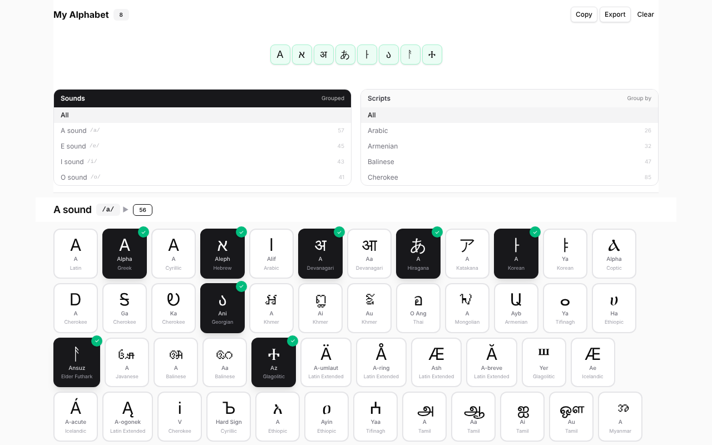
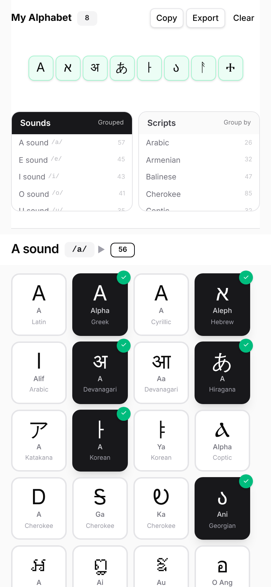

# Alphabet Designer

Alphabet Designer lets you pick characters from writing systems around the
world and combine them into your own alphabet. Browse by sound or by script,
tap the characters you like, then copy or export the result.

**Live:** [alphabet-draft.vercel.app](https://alphabet-draft.vercel.app)





## Features

- **Over 1,000 characters from 32 scripts**, including Tengwar (Elvish), sorted
  into 38 vowel and consonant sound groups.
- **Two filter panes.** Filter by sound and by script at the same time, and
  group the results by either one.
- **My Alphabet panel.** Your picks appear as a keyboard that stays pinned at
  the top of the page.
- **Copy and export.** Copy the alphabet to the clipboard, or download it as a
  tab-separated text file with each character's name, script, and sound.
- **Hear each sound.** Tap a sound group's IPA label to hear it through the
  browser's speech synthesis.
- **Long-press to copy.** Long-press any character to copy just that one.
- **Saved selections.** Your alphabet stays in the browser's local storage
  between visits.

## How it's built

- Next.js 16 (App Router), React 19, TypeScript, and Tailwind CSS 4.
- Radix UI primitives with shadcn/ui-style components.
- All character data lives in `src/data/alphabets.ts`. Tengwar glyphs render as
  inline SVGs from `src/data/tengwar-glyphs.ts`, so they don't depend on a
  private-use-area font.
- The app is a single static page with no backend.

## Run it locally

1.  Install the dependencies:

    ```bash
    npm ci
    ```

1.  Start the development server:

    ```bash
    npm run dev
    ```

1.  Open <http://localhost:3000>.

To serve a production build, run `npm run build`, then `npm start`.

## Test

The project has no automated tests. Use the linter and the production build as
checks:

```bash
npm run lint
npm run build
```

## License

The code in this repository is not licensed for reuse. All rights reserved.
